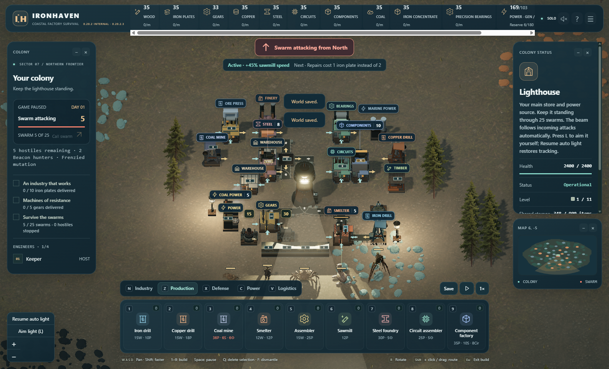
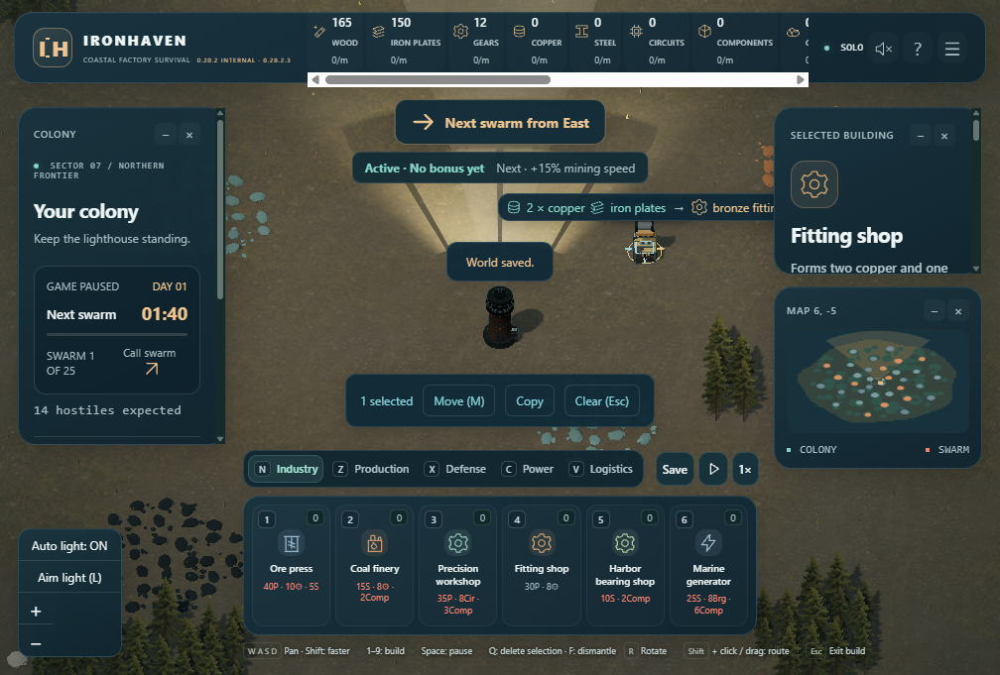

# Coastal industry and Lua modding — internal 0.20.2.3

23 November 2026. Baseline `27a6062`; branch `feature/lua-modding-industry`. Package SemVer 0.20.2, final separate internal build 0.20.2.3 (gameplay validation began at 0.20.2.2). This is an internal development change. Public patcher remains v0.20.1; no release tag or promotion is authorized by this task.

## Content and research

The official Factorio mod portal identifies established industrial/content references including [Krastorio 2](https://mods.factorio.com/mod/Krastorio2), [Angel's Refining](https://mods.factorio.com/mod/angelsrefining), [Bob's Metals, Chemicals and Intermediates](https://mods.factorio.com/mod/bobplates), [AAI Containers & Warehouses](https://mods.factorio.com/mod/aai-containers) and [Space Exploration](https://mods.factorio.com/mod/space-exploration). This is a research shortlist, not a universal ranking across versions. Bob's and AAI pages were inspected again for this task. They illustrate richer processing, useful intermediates and understandable logistics. Space transport is not copied into the coastal theme. No mod source/art is incorporated; applicable mod licenses often restrict commercial derivatives or redistribution.

The implemented original industrial slice:

| Machine | Physical recipe / function | Tradeoff |
| --- | --- | --- |
| Ore press | 2 ore →1 concentrate /4s | 5 power, extra machine and transport |
| Coal finery | 1 concentrate +1 coal →3 plates /5s | 7 power, coal and component construction cost |
| Precision workshop | 2 steel +1 copper →1 bearing /6s | 6 power and components to establish precision production |
| Marine generator | 54 power for 1 coal /16s | Bearings and components to build instead of a cheap generator |

The basic 1:1 smelter route remains available. Refining offers 50% more plates per ore but does not guarantee a superior factory: fuel, power, output space and physical routes matter. Bearings provide a civilian component sink. New items share the same combined warehouse capacity and local export ownership as existing materials. Multi-item batches consume inputs only when all output fits. No extra ores, fluids, recycling, research tree, harbors or cross-map XP were added.

Models reuse existing authored workshop/engine geometry with original press/flue/lathe/turbine equipment variants. Industry (N), inspector recipes, resource/production reports and field guide/tutorial are integrated. This is not a comprehensive texture redesign or proof of commercial visual quality.

## Modding

[API guide and installation](../MODDING.md). Real Lua via MIT Fengari 0.1.5; manifests, dependency ordering, three data stages, local cached require, deepcopy and data.raw/data:extend. Smaller API than Factorio; no claim of unchanged Factorio mod compatibility. Installed Windows startup reads only enabled ordinary mod folders, compiles in a separate instruction/time/heap-bounded worker and injects validated data into the existing sandboxed app. Build includes worker, shipped-base catalog, example folders and software notices.

Unsupported runtime/settings scripts, unknown prototype/graphics fields, invalid references/costs/batches and reserved overrides fail explicitly. Lua has no system/Node/Electron API. Base catalog hash and enabled mod versions/source hashes bind saves and LAN invitations. Legacy unmodded saves remain supported; missing/changed mods are not silently discarded. Example machining mod adds bronze fittings and an alternative bearing chain with real UI/simulation/storage integration. Custom assets, runtime events/state, locale, migrations, ZIPs, mod downloads, in-game management and Workshop remain future work.

## Validation checkpoint

- Full local suite: **203 passed**, no failures. Focused SDK/industry **10 passed** after final validator changes. Tests cover actual Lua/module stages, dependencies, isolation/budget, transactional failures, Windows folder rules, worker execution, modded production, warehouse accounting, saves and LAN mismatch, plus native DOM controls for Industry.
- `npm run build`: passed; `node scripts/check-mods.mjs work/mod-example`: passed through bundled `release/mod-worker.cjs`, reporting the example and 13 total item prototypes/13 recipe-machine-or-generator prototypes.
- `npm run test:render` with system Chromium/SwiftShader: passed. Zoom/count pairs 14/80, 44/80, 14/160, 44/420 had zero non-finite framebuffer values and no page errors. Lamp placement passed relative completed-frame bounds. Absolute software raster times are not Windows hardware FPS.
- Exploratory scripted campaigns used only normal commands/earned resources. Two early variants were unsuitable as new-feature evidence: replacing a smelter before completing the chain, and then reserving a drill site already occupied by a planned sentry. Corrected to an additional fully funded line with collision assertions. These pilots do not establish that the content is balanced.
- At the initial checkpoint the source-pinned campaign comparison and native Windows checks were pending. Their completed evidence is recorded below.

## Reproduce

```sh
npm ci
npm test
npm run build
node scripts/check-mods.mjs work/mod-example
CHROME_BIN=/usr/bin/chromium npm run test:render
node scripts/play-campaign.mjs 417 refining relaxed 9000 campaign
node scripts/play-campaign.mjs 2026 refining standard 9000 campaign
```

For the CLI example check, first copy `examples/mods/harbor-machining` to a chosen mods directory and add `mod-list.json` as documented. Raw render fixtures and saves in ignored `work/` are not published gameplay or an earned colony screenshot. On Windows `./scripts/build-windows.ps1` performs ordinary native smoke/captures and a second actual enabled-example-mod startup/placement/save check.

## Final source-pinned campaigns

Six final validation runs used two workers and ordinary commands/earned materials, all pinned to `4596cc3cd8f198149dcff0b9abf2b40d26ae6c87` (internal 0.20.2.2). Ten earlier exploratory runs were separate; layout/commissioning pilots are not pooled into the final sample. Final UI/capture polish in 0.20.2.3 changed no simulation, catalog, Lua compiler or campaign-driver behavior. [Raw final results](industry-2026-11-23-results.json).

| Seed | Strategy | Difficulty | Outcome | Last swarm | Simulated seconds | Concentrate produced |
| ---: | --- | --- | --- | ---: | ---: | ---: |
| 417 | industry | standard | defeat | 25 | 4860 | 0 |
| 2026 | pulse | standard | victory | 25 | 5216 | 0 |
| 417 | industry | relaxed | victory | 25 | 5194 | 0 |
| 2026 | industry | standard | defeat | 24 | 4987 | 0 |
| 417 | refining | relaxed | victory | 25 | 5251 | 9 |
| 2026 | refining | standard | defeat | 24 | 4806 | 57 |

The six final runs produced three campaign victories and three defeats, with no horizon stops. The additional refining line was commissioned from earned materials in both refining cases. Against matched industry controls: Relaxed seed 417 still won, 57 simulated seconds later; Standard seed 2026 still lost at swarm 24, 181 seconds earlier. Concentrate production demonstrates the line actually ran, but these results do not demonstrate a general balance improvement. A single standard mixed-defense case and a pulse case also reproduced the previously observed outcomes.

This is a two-seed validation sample, not the recurring 35-case balance program, a human playtest or a 20-hour endurance claim. Precision bearings/marine generation have physical accounting and construction tests, but are not a separately tuned earned-resource campaign strategy yet. Next: broaden holdouts, test fuel/power reserve and commissioning timing, and measure the complete bearing/power route before calling the new economy balanced.

## Native Windows verification and internal download

Final game/UI build **0.20.2.3** (`4c8fced`), artifact-retention workflow `3b2fff5`, merged via [PR #27](https://github.com/Guffy-dk/Ironhaven/pull/27) at `6cc6863`. [Final CI run](https://github.com/Guffy-dk/Ironhaven/actions/runs/45248228613): Linux verify and Windows both passed. The separate final UI/capture adjustment did not change simulation, Lua compiler, catalog or campaign driver from the six-run source above.

The native Windows script verified real startup, graphics, lighthouse/lamp controls, settings, numbered ports, ordinary capture fixtures and a second enabled-folder-mod launch. That second launch compiled the example with the packaged worker, placed a fitting shop using starter materials and saved a matching content signature. [Native log excerpt](industry-2026-11-23-windows.log). The regular colony capture is a paused QA fixture, not an earned campaign. The modded startup capture uses normal initial construction; neither image is concept art. Native CI uses software rendering and is not hardware FPS validation.





[Internal Windows ZIP and SHA manifest](https://github.com/Guffy-dk/Ironhaven/actions/runs/45248228613/artifacts/14853689568) are retained as an Actions artifact for 14 days. This is an internal manual-install build, not a patcher update: extract the artifact, extract Ironhaven-Windows-x64.zip, then run Ironhaven.exe from the entire extracted game folder. The included Modding directory has the guide and example. [All seven native screenshots](https://github.com/Guffy-dk/Ironhaven/actions/runs/45248228613/artifacts/14855310176) remain an additional CI artifact. Essential two captures and result summaries are versioned here because Actions artifacts expire.

[Local render measurements](industry-2026-11-23-render.json) have no non-finite output/page errors and passed placement bounds. They were collected during the implementation iteration, separately from the source-pinned campaigns and final native Windows run.

Public patcher rechecked as v0.20.1 before completion. No public release/tag/promotion or published-installation test was performed; publication remains explicitly gated by the owner. The paused recurring balance agent was not restarted.
